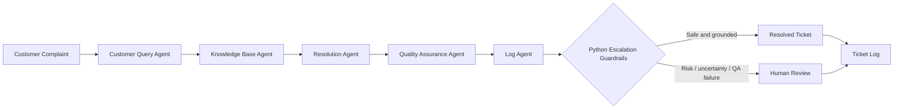

# 🛒 NexaCart AI Customer Support Desk
### AI Customer Support Automation | Social Eagle AI Buildathon 2.0

An intelligent, policy-grounded customer support prototype built with **Microsoft AutoGen, Python, Streamlit, RAG, FAISS, and Pydantic**.

NexaCart uses five specialized AI agents to analyze customer complaints, retrieve relevant company policy, draft and validate responses, and log or escalate tickets—with human oversight for sensitive or uncertain cases.

---

## 🖥️ Application Preview

### Home — Support Desk Dashboard


### Resolved Ticket — Policy-Grounded Response


### Escalated Ticket — Risk-Aware Human Handoff


### Ticket Log — Traceability and Monitoring


---

## 🏗️ System Architecture


The application follows a controlled multi-agent pipeline:



## 🤖 The Five AutoGen Agents

| Agent | Responsibility |
|---|---|
| **1. Customer Query Agent** | Classifies complaint category, urgency, sentiment, language, risk flags, and search intent |
| **2. Knowledge Base Agent** | Retrieves relevant company policy passages through the RAG pipeline |
| **3. Resolution Agent** | Drafts an empathetic response grounded in retrieved evidence |
| **4. Quality Assurance Agent** | Checks evidence grounding, citations, coverage, and response quality |
| **5. Log Agent** | Proposes ticket disposition and prepares ticket records |

## ✨ Key Features

- **Policy-grounded RAG:** Responses are based on company knowledge documents rather than unsupported assumptions.
- **Hybrid retrieval:** Lexical ranking and dense retrieval are combined through relevance-gated ranking fusion.
- **FAISS vector search:** Includes a NumPy / scikit-learn fallback.
- **Pydantic data validation:** Validates complaint inputs and structured agent outputs.
- **QA / Critic agent:** Verifies response grounding and citations.
- **Escalation guardrails:** High urgency, legal threats, fraud/payment disputes, very angry sentiment, low confidence, missing evidence, QA failure, or agent errors trigger escalation.
- **Human-in-the-loop review:** Risky and unsupported cases are routed for human review.
- **Ticket logging:** Records ticket status and supports review/export.
- **Multilingual complaint handling:** Tested with English, Tamil, Hindi, and Spanish sample complaints.
- **RAG evaluation:** Includes a bundled retrieval evaluation dataset and metrics.
- **Streamlit UI:** Support Desk, Ticket Log, Human Review, Knowledge Base, RAG Evaluation, and How It Works tabs.

## 🧪 Testing Summary

| Validation | Result |
|---|---:|
| Mandatory Buildathon scenarios | 6 covered |
| Additional custom scenarios | 2 covered |
| Pydantic model tests | 10 passed |
| Integrated automated tests | 23 passed |
| Sample same-language responses | English, Tamil, Hindi, Spanish |
| Retrieval benchmark | Evaluated on bundled sample dataset |

> **Note:** Retrieval metrics are specific to the small bundled evaluation set and should not be interpreted as production-wide accuracy guarantees. French response quality has not yet been formally validated.

Run automated tests:

```bash
python -m pytest -v
```

## 🧰 Technology Stack

| Technology | Usage |
|---|---|
| Python | Core application and orchestration |
| Microsoft AutoGen | Multi-agent collaboration |
| Streamlit | Interactive user interface |
| OpenAI model (`gpt-4o-mini`) | Complaint analysis and response generation |
| RAG | Knowledge-grounded question answering |
| FAISS | Vector similarity search |
| BM25 / lexical retrieval | Keyword-based passage ranking |
| Pydantic | Structured data validation |
| Pandas / NumPy | Data processing and retrieval support |
| Pytest | Automated testing |

## 📂 Project Structure

```text
nexacart-crm-autogen-buildathon/
├── app.py
├── cli.py
├── run_app.cmd
├── run_app.sh
├── requirements.txt
├── .env.example
├── README.md
├── data/
├── docs/
│   ├── ARCHITECTURE.md
│   ├── TEST_CASES.md
│   ├── USER_GUIDE.md
│   ├── TECHNICAL_DESIGN.md
│   ├── SUBMISSION_POST.md
│   ├── nexacart-system-architecture-and-design-flow.png
│   ├── sample_logs/
│   └── screenshots/
│       ├── 01_home.png
│       ├── 02_resolved_ticket.png
│       ├── 03_escalated_ticket.png
│       └── 04_ticket_log.png
├── knowledge_base/
├── support_desk/
│   └── agents/
├── tests/
├── logs/
└── vector_store/
```

## 📚 Documentation

- [System Architecture](docs/ARCHITECTURE.md)
- [Technical Design](docs/TECHNICAL_DESIGN.md)
- [Test Cases and Results](docs/TEST_CASES.md)
- [User Guide](docs/USER_GUIDE.md)
- [Buildathon Submission Post](docs/SUBMISSION_POST.md)

## 🚀 Run Locally

### Prerequisites
- Python 3.12 recommended
- OpenAI API key (optional if using supported offline fallback)

### Windows — Command Prompt

```cmd
cd "D:\!Social Eagle AI\Social Eagle Labs\nexacart-crm-autogen-buildathon"
.venv\Scripts\activate.bat
run_app.cmd
```

### Run directly

```bash
python -m streamlit run app.py
```

Then open the local URL printed in the terminal (typically `http://localhost:8501`).

### Environment configuration

1. Copy `.env.example` to `.env`.
2. Add the required configuration values.
3. Keep `.env` private and **never commit API keys or credentials**.

## 🔐 Responsible Use and Limitations

This is a **Buildathon prototype**, not a production-certified customer support system.

- Do not submit real customer PII or confidential production data.
- Protect API credentials, local logs, and exported ticket files.
- Multilingual quality and retrieval are not exhaustively evaluated.
- Offline hashing-based vectors are a fallback and are not equivalent to pretrained semantic embeddings.
- Production deployment would require authentication, authorization, privacy controls, rate limiting, monitoring, audit policies, and formal evaluation.

---

## 🙌 Project

Built as part of **Social Eagle AI — Buildathon 2.0**.

Feedback and suggestions are welcome!
