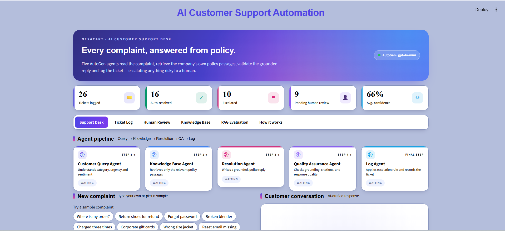
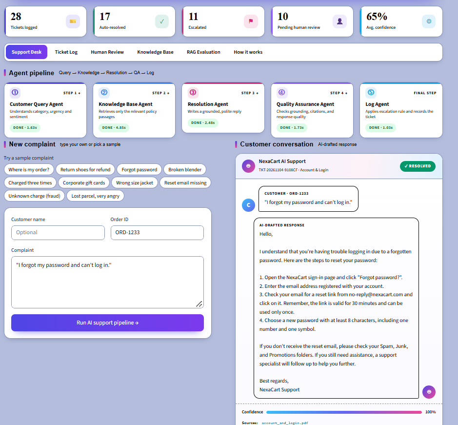
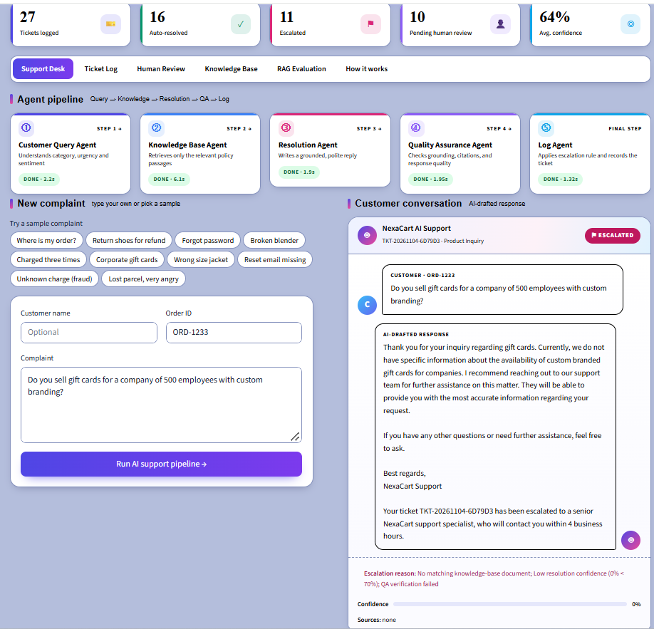
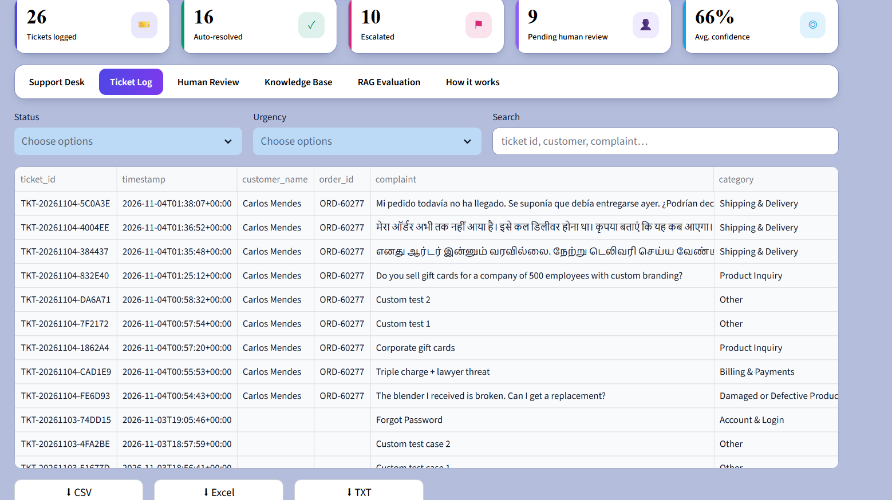
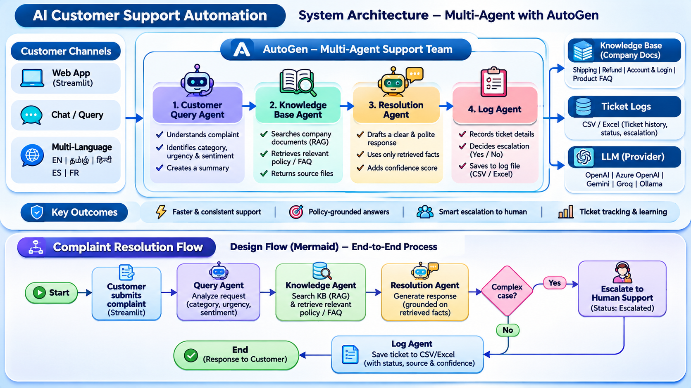
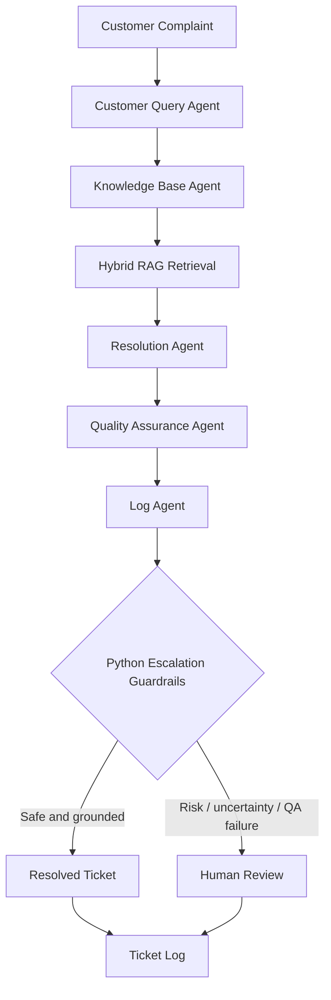

# 🛒 NexaCart AI Customer Support Desk

### Multi-Agent Customer Support Automation | Social Eagle AI Buildathon 2.0

[](https://github.com/ksmurari1/nexacart-crm-buildathon2/actions)


An intelligent, policy-grounded customer support prototype built with **Microsoft AutoGen, Python, Streamlit, Hybrid RAG, FAISS, and Pydantic**.

NexaCart uses five specialized AI agents to analyze customer complaints, retrieve relevant company policies, draft and validate responses, and log or escalate tickets—with human oversight for sensitive or uncertain cases.

---

## 🎯 Problem Statement

Traditional customer support operations face challenges such as:
- High volumes of repetitive customer complaints
- Slow response and resolution times
- Inconsistent policy interpretation
- Risk of unsupported or inaccurate responses
- Limited visibility into escalations and ticket history

## 💡 Solution

NexaCart AI combines multi-agent orchestration with Retrieval-Augmented Generation (RAG) to deliver policy-grounded support responses while preserving human oversight.

The system classifies incoming complaints, retrieves relevant policy evidence, generates a response, performs quality checks, and determines whether the ticket can be resolved or requires human review.

---

## 🖥️ Application Preview

### Home — Support Desk Dashboard



### Resolved Ticket — Policy-Grounded Response



### Escalated Ticket — Risk-Aware Human Handoff



### Ticket Log — Traceability and Monitoring



---

## 🏗️ System Architecture



### Multi-Agent Workflow



---

## 🤖 The Five AutoGen Agents

| Agent | Responsibility |
|---|---|
| **Customer Query Agent** | Classifies complaint category, urgency, sentiment, language, risk flags, and search intent |
| **Knowledge Base Agent** | Retrieves relevant company policy passages using Hybrid RAG |
| **Resolution Agent** | Generates empathetic, evidence-grounded customer responses |
| **Quality Assurance Agent** | Evaluates response grounding, citations, coverage, and quality |
| **Log Agent** | Proposes ticket disposition and prepares structured ticket records |

---

## ✨ Key Features

- **Multi-Agent Orchestration:** Five specialized AutoGen agents collaborate in a controlled pipeline.
- **Hybrid RAG:** Combines BM25 lexical retrieval and dense vector similarity.
- **Reciprocal Rank Fusion (RRF):** Merges retrieval rankings.
- **FAISS Vector Search:** Efficient similarity search with fallback support.
- **Offline Retrieval:** Hashing-based vectors enable retrieval without embedding API access.
- **Adaptive Retrieval:** Offline ranking includes calibrated, source-specific intent boosts.
- **QA / Critic Agent:** Checks evidence grounding and response quality.
- **Escalation Guardrails:** Identifies high-risk, uncertain, or unsupported cases.
- **Human-in-the-Loop:** Routes sensitive cases to human review.
- **Pydantic Validation:** Enforces structured input and agent output validation.
- **Ticket Logging:** Maintains traceability and supports review/export.
- **Multilingual Support:** Sample complaints tested in English, Tamil, Hindi, and Spanish.
- **Interactive Streamlit UI:** Support Desk, Ticket Log, Human Review, Knowledge Base, RAG Evaluation, and How It Works.

---

## 📊 RAG Evaluation

### Offline Retrieval Benchmark

| Metric | Before Optimization | After Optimization |
|---|---:|---:|
| Hit@1 | 84.21% | **100%** |
| Hit@K | 100% | **100%** |
| Mean Reciprocal Rank (MRR) | 92.11% | **100%** |

**Evaluation summary:**
- 19 relevant benchmark queries correctly retrieved the expected source at Rank 1.
- An irrelevant query was correctly handled through retrieval abstention.
- Retrieval improvements were validated through offline diagnostic evaluation.
- Full automated test suite: **28 passed**.

> **Evaluation limitation:** These results reflect a small bundled benchmark, not guaranteed production-wide retrieval accuracy. Rule-based intent boosts are limited to offline fallback mode.

---

## 🧪 Testing and Continuous Integration

Run the test suite locally:

```bash
python -m pytest -v
```

Automated testing is integrated with GitHub Actions.

[View CI workflow and execution history](https://github.com/ksmurari1/nexacart-crm-buildathon2/actions)

---

## 🧰 Technology Stack

| Technology | Purpose |
|---|---|
| Python 3.12 | Core application |
| Microsoft AutoGen | Multi-agent orchestration |
| Streamlit | Interactive application interface |
| OpenAI `gpt-4o-mini` | Complaint analysis and response generation |
| RAG | Knowledge-grounded response generation |
| BM25 | Lexical retrieval |
| FAISS | Dense vector similarity search |
| Reciprocal Rank Fusion | Hybrid ranking |
| Pydantic | Structured data validation |
| Pandas / NumPy | Data processing |
| Pytest | Automated testing |
| GitHub Actions | Continuous integration |

---


## 📂 Project Structure

```text
nexacart-crm-buildathon2/
├── app.py
├── requirements.txt
├── .env.example
├── README.md
├├── data/
├── knowledge_base/
├├── support_desk/
│   ├── agents/
│   ├── config.py
│   ├── escalation.py
│   ├── evaluate_cli.py
│   ├── evaluation.py
│   ├── knowledge_base.py
│   ├── memory.py
│   ├── models.py
│   ├── pipeline.py
│   ├── team.py
│   ├── ticket_log.py
│   ├── ui_styles.py
│   └── ui_tabs.py
├── tests/
├── docs/
│   ├── ARCHITECTURE.md
│   ├── TECHNICAL_DESIGN.md
│   ├── TEST_CASES.md
│   ├── USER_GUIDE.md
│   ├── SUBMISSION_POST.md
│   ├── nexacart-system-architecture-and-design-flow.png
│   └── screenshots/
│       ├── 01_home.png
│       ├── 02_resolved_ticket.png
│       ├── 03_escalated_ticket.png
│       └── 04_ticket_log.png
└── vector_store/
```
---

## 📚 Documentation

| Document | Description |
|---|---|
| [System Architecture](docs/ARCHITECTURE.md) | Agent architecture and workflow |
| [Technical Design](docs/TECHNICAL_DESIGN.md) | Implementation and design decisions |
| [Test Cases](docs/TEST_CASES.md) | Test scenarios and validation |
| [User Guide](docs/USER_GUIDE.md) | Application usage |
| [Submission Post](docs/SUBMISSION_POST.md) | Buildathon summary |

---

## 🚀 Quick Start

### Prerequisites
- Python 3.12 recommended
- Git
- OpenAI API key (optional if using supported offline fallback)

### 1. Clone the repository

```bash
git clone https://github.com/ksmurari1/nexacart-crm-buildathon2.git
cd nexacart-crm-buildathon2
```

### 2. Create and activate a virtual environment

**Windows — PowerShell**

```powershell
python -m venv .venv
.\.venv\Scripts\Activate.ps1
```

**Windows — Command Prompt**

```cmd
python -m venv .venv
.venv\Scripts\activate.bat
```

**Linux / macOS**

```bash
python3 -m venv .venv
source .venv/bin/activate
```

### 3. Install dependencies

```bash
pip install -r requirements.txt
```

### 4. Configure environment

Copy `.env.example` to `.env` and configure the required values.

Keep your `.env` private. Never commit API keys or credentials.

### 5. Launch the application

```bash
python -m streamlit run app.py
```

Open the local URL displayed in the terminal, typically:

```text
http://localhost:8501
```

---

## 🎬 Demo Flow

Recommended walkthrough for reviewers:

1. **Home Dashboard** — Introduce the NexaCart support desk.
2. **Submit a customer complaint** — Demonstrate classification and analysis.
3. **Knowledge Retrieval** — Show policy evidence returned by Hybrid RAG.
4. **Resolution** — Review the grounded customer response.
5. **Escalation Scenario** — Demonstrate human review for a sensitive or uncertain complaint.
6. **Ticket Log** — Show ticket tracking and traceability.
7. **RAG Evaluation** — Explain retrieval metrics and offline fallback.
8. **Architecture** — Summarize the five agents and guardrails.

---

---

## ⚠️ Responsible Use and Limitations

NexaCart AI Customer Support Desk is an educational Buildathon prototype intended for demonstration and experimentation.

- AI-generated responses must be reviewed before customer delivery.
- Unsupported or sensitive requests should be escalated to a human.
- The bundled RAG evaluation results represent a small curated dataset and do not guarantee production-wide accuracy.
- Offline retrieval uses deterministic hashing-based vectors and is not equivalent to pretrained semantic embeddings.
- The application has not undergone formal production security, compliance, or performance certification.
- Do not use real customer personally identifiable information (PII) or confidential production data.

---

## 🏆 Buildathon Acknowledgement

Built as part of **Social Eagle AI Buildathon 2.0**, exploring practical applications of Generative AI, multi-agent orchestration, Hybrid RAG, evaluation, and responsible AI.

---

---
## 🔐 Security

Please review our [Security Policy](SECURITY.md) for information
on reporting vulnerabilities and security practices.

Feedback and suggestions are welcome!