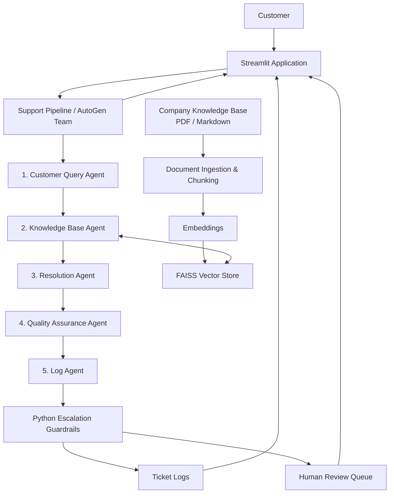
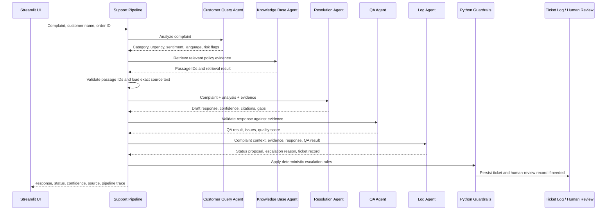
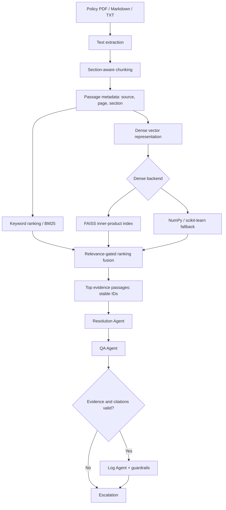

# NexaCart Support Desk — Architecture

## Overview
NexaCart is a policy-grounded AI customer support application built with Streamlit and Microsoft AutoGen. Five specialized agents collaborate in a controlled pipeline to analyze complaints, retrieve company knowledge, draft responses, validate quality, and log outcomes.

## High-Level Architecture

## Agent Execution Sequence

## Agent Responsibilities
| Agent | Responsibility | Typical output |
|---|---|---|
| Customer Query Agent | Understand and classify the complaint | Category, urgency, sentiment, language, risk flags, summary, search query |
| Knowledge Base Agent | Find relevant company policy evidence | Passage IDs, retrieval status, search rationale |
| Resolution Agent | Draft an empathetic response grounded in retrieved evidence | Reply, confidence, citations, knowledge gaps |
| Quality Assurance Agent | Check grounding, citations, coverage, and response quality | Pass/fail, issues, score, valid citations |
| Log Agent | Propose disposition and record the case | Status proposal, escalation reason, ticket details |

## Retrieval Architecture

## Escalation Guardrails
The deterministic Python guardrail can make a proposed outcome stricter; it must not override a mandatory escalation with an automatic resolution.

Escalation conditions include:
- High urgency
- Very angry customer sentiment
- Legal threat, fraud, or payment dispute
- No relevant knowledge passage
- Low resolution confidence
- QA verification failure
- Agent error, timeout, or incomplete processing

## Logging and Human Review
Ticket activity is persisted under `logs/`. The application supports ticket-log inspection and a human-review workflow for escalated cases. Human-review records can track pending review and approval/edit outcomes.

## Design Principles
- **Grounded generation:** policy details must come from retrieved source passages.
- **Separation of concerns:** each agent has a narrowly defined responsibility.
- **Defense in depth:** model decisions are checked by QA and deterministic Python rules.
- **Safe failure:** missing evidence or processing errors result in escalation rather than fabricated policy.
- **Traceability:** retain classification, source evidence, response, QA outcome, status, and ticket record.
- **Human oversight:** sensitive or uncertain cases are routed to a person.
