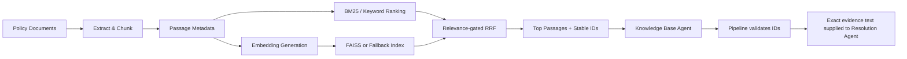

# NexaCart Support Desk — Technical Design

## 1. Technology Stack
| Layer | Technology | Role |
|---|---|---|
| UI | Streamlit | Interactive complaint desk and dashboards |
| Agent orchestration | Microsoft AutoGen AgentChat | Multi-agent workflow |
| LLM | Configured OpenAI model (project currently uses `gpt-4o-mini`) | Classification and response generation |
| Data contracts | Pydantic | Input and agent-output validation |
| Retrieval | Hybrid lexical + dense retrieval / ranking fusion | Policy passage discovery |
| Vector index | FAISS, with NumPy / scikit-learn fallback | Similarity search |
| Embeddings | OpenAI embeddings when configured; offline hashing fallback | Text vectorization |
| Data processing | Python, Pandas | Ticket and evaluation data |
| Testing | Pytest | Automated validation |
| Persistence | CSV / TXT / XLSX | Ticket logs and review/evaluation records |

## 2. Application Modules
| Module | Responsibility |
|---|---|
| `app.py` | Streamlit application entry point |
| `cli.py` | Command-line entry point |
| `support_desk/config.py` | Configuration and environment handling |
| `support_desk/team.py` | AutoGen agent/team configuration |
| `support_desk/pipeline.py` | Pipeline orchestration and step execution |
| `support_desk/models.py` | Pydantic schemas |
| `support_desk/knowledge_base.py` | Ingestion, indexing, and retrieval |
| `support_desk/escalation.py` | Deterministic escalation rules |
| `support_desk/ticket_log.py` | Ticket and review persistence |
| `support_desk/evaluation.py` | Retrieval evaluation metrics |
| `support_desk/evaluate_cli.py` | Evaluation command-line runner |
| `support_desk/ui_styles.py` | Streamlit styling |
| `support_desk/ui_tabs.py` | Tab / UI composition |
| `support_desk/agents/` | Individual agent definitions |
| `tests/` | Automated validation |

## 3. Pipeline Data Contracts
### `ComplaintInput`
Validates the initial complaint and optional customer/order fields.

### `AgentAnalysis`
Structured complaint analysis: category, urgency, sentiment, language, risk flags, summary, order ID, and search query.

### `ResolutionOutput`
Drafted customer response, confidence, citations, and knowledge gaps.

Pydantic validation is applied at pipeline boundaries to reduce malformed or inconsistent agent output. Validation or agent failures should follow safe fallback behavior and must not silently be treated as normal successful resolution.

## 4. Knowledge Ingestion and Retrieval

### Source Processing
- Reads supported company knowledge documents, including PDF and Markdown/text formats.
- Extracts text and organizes it into section-aware passages.
- Retains source, page, and section metadata where available.
- Avoids duplicate retrieval when PDF and Markdown twins share a stem, preferring PDF.

### Retrieval Strategy
The implementation combines lexical ranking (BM25) and dense retrieval. Candidate rankings are fused using relevance-gated Reciprocal Rank Fusion (RRF).

### Dense Backend
- With an OpenAI API key and configured embeddings, embeddings are generated and cached.
- Offline fallback uses deterministic `HashingVectorizer` from scikit-learn. This is a lexical baseline, not a pretrained semantic embedding model.
- FAISS `IndexFlatIP` is used when available.
- NumPy / scikit-learn provides a fallback if FAISS is unavailable.
- Cache/index names incorporate a corpus fingerprint so document changes can invalidate the cached index.

## 5. Grounded Response Generation
The Knowledge Base Agent returns passage identifiers and retrieval rationale. The pipeline validates identifiers and supplies exact passage text from the source corpus to the Resolution Agent.

The Resolution Agent is expected to:
- Answer the customer's actual question.
- Use supplied evidence.
- Include source references/citations.
- State knowledge gaps where policy evidence is missing.
- Avoid unsupported guarantees, timelines, or policy claims.

The QA Agent checks the draft against evidence and validates citations and response quality. QA failure contributes to escalation.

## 6. Escalation Logic
Escalation uses two layers:
1. **Agent proposal:** the Log Agent proposes disposition based on case context and pipeline outputs.
2. **Deterministic Python guardrail:** `support_desk/escalation.py` enforces mandatory rules.

The guardrail can make a decision stricter; it cannot downgrade a mandatory escalation.

### Mandatory escalation signals
- High urgency
- Very angry sentiment
- Legal threat
- Fraud or payment dispute
- No relevant evidence
- Low confidence
- QA failure
- Agent error or timeout

## 7. Logging and Human Review
The application records ticket information under `logs/`, including formats used by the UI and export workflow. Escalated cases are surfaced in the Human Review tab with a review status. Where supported, reviewers can approve or edit the proposed response, with review information persisted separately.

## 8. RAG Evaluation
The bundled benchmark in `data/rag_evaluation.json` includes answerable questions and a no-match case.

Metrics:
- **Hit@1:** relevant result at rank one
- **Hit@k:** relevant result in the top-k
- **MRR:** reciprocal rank of the first relevant result
- **No-match accuracy:** expected unanswerable queries correctly identified

The benchmark is local and reproducible; metric computation does not require an LLM call. Scores are specific to the bundled dataset.

## 9. Failure and Fallback Behavior
| Failure | Behavior |
|---|---|
| API key unavailable | Deterministic offline mode |
| Agent timeout / exception | Safe fallback and ticket escalation |
| Invalid structured output | Pydantic validation catches it; pipeline fallback applies |
| No relevant passage | Abstain from unsupported policy claims and escalate |
| QA failure | Escalate |
| FAISS unavailable | Supported NumPy / scikit-learn fallback |
| OpenAI embeddings unavailable | Deterministic hashing vectors |

## 10. Configuration and Secrets
Configuration is managed through environment variables and local `.env`. `.env.example` documents expected settings without real secrets.

Never commit API keys, production customer information, private ticket exports, credentials, or tokens.

## 11. Prototype Boundaries
- Buildathon prototype; not production-certified.
- Multilingual behavior tested on sample English, Tamil, Hindi, and Spanish complaints; coverage is not exhaustive.
- RAG scores reflect a small curated benchmark.
- Offline hashing vectors are not equivalent to pretrained semantic embeddings.
- Production readiness would require authentication, authorization, PII controls, rate limiting, monitoring, audit retention, robust deployment, and formal evaluation.
